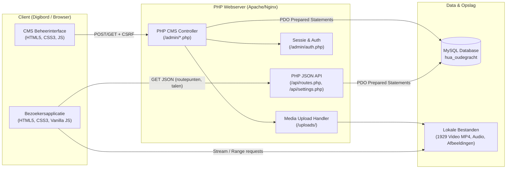
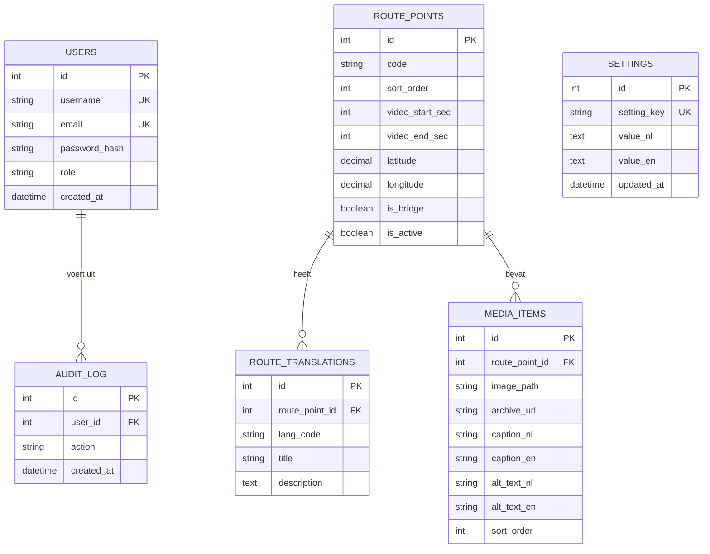
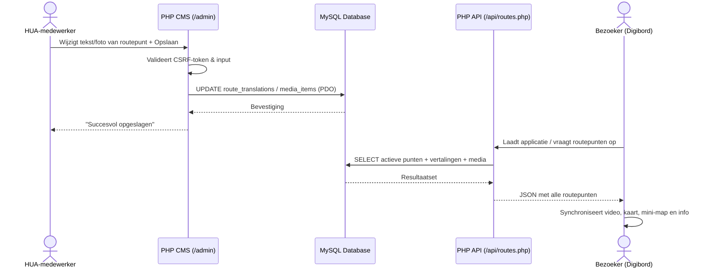

# Technisch Ontwerp (TO) – *Ontmoet de Oudegracht*

## 1. Inleiding

### Doel en context
Dit Technisch Ontwerp (TO) beschrijft de technische architectuur, datastructuur, beveiliging en functionaliteiten van de interactieve webapplicatie en het bijbehorende CMS voor **Het Utrechts Archief (HUA)** ten behoeve van de tentoonstelling *'Ontmoet de Oudegracht'* (opening maart 2027, oplevering prototype/eindproduct 7 december 2026).

### Overzicht van het document
In dit document komen de systeemeisen, de applicatiearchitectuur, het datamodel (ERD), de gekozen technologieën (PHP/MySQL zonder Node.js), beveiligingsmaatregelen, functionele logica, UI/wireframes en de teststrategie aan bod.

---

## 2. Systeemeisen

### Hardware- en software-eisen
- **Webserver:** Apache 2.4+ of Nginx met **PHP 8.1 of hoger**.
- **Database:** MySQL 8.0+ of MariaDB 10.5+.
- **Restrictie:** Het project draait volledig op PHP en MySQL; er wordt **geen Node.js** of andere server-side JavaScript-runtime gebruikt.
- **Weergavehardware tentoonstelling:** Groot digibord met touch-functionaliteit (aanbevolen resolutie 1920×1080 Full HD of 3840×2160 4K, 16:9).

### Browser- en apparaatcompatibiliteit
De bezoekersapplicatie en het CMS zijn compatibel met de laatste versies van:
- **Browsers:** Google Chrome, Mozilla Firefox, Apple Safari, Microsoft Edge.
- **Apparaten:** Groot touch-digibord (primair), desktop/laptop (CMS & beheer), tablet en smartphone (responsive).

---

## 3. Architectuur en Componenten

### Architectuurmodel
De applicatie volgt een klassieke **Client-Server architectuur** met een duidelijke scheiding tussen de publieke bezoekersapplicatie, het beveiligde CMS en een JSON-API-laag in PHP die communiceert met de MySQL-database.



### Frontend
- **Opbouw:** Semantisch HTML5, modulaire CSS3 (met CSS Custom Properties voor de HUA-huisstijlkleuren) en Vanilla JavaScript (ES6 modules, geen build-stap nodig).
- **Video-Kaart-synchronisatie:** HTML5 `<video>`-element gekoppeld via `timeupdate`-eventlisteners aan een interactieve kaart (Leaflet.js of Google Maps 3D-laag) en een onderste mini-map/voortgangsbalk.

### Backend
- **PHP (PDO):** Server-side logica opgedeeld in `/api/` (publieke read-only JSON-endpoints voor de frontend) en `/admin/` (beveiligde CMS-pagina's voor CRUD-operaties).
- Alle databasecommunicatie verloopt via **PHP Data Objects (PDO)** met prepared statements.

### Database
- Relationele MySQL-database (`hua_oudegracht`) met tabellen voor routepunten, meertalige content (NL/EN), gekoppelde archiefafbeeldingen, CMS-gebruikers en algemene applicatie-instellingen (zoals colofon- en startuitlegteksten).

---

## 4. Data Model

### Entity Relationship Diagram (ERD)



### Beschrijving van tabellen en relaties
- **`users`**: Slaat CMS-beheerders op (`id`, `username`, `email`, `password_hash`, `role`, `created_at`).
- **`route_points`**: Bevat de ankerpunten langs de Oudegracht (`id`, `code` zoals `1`, `1a`, `2`, `sort_order`, `video_start_sec`, `video_end_sec`, `latitude`, `longitude`, `is_bridge`, `is_active`).
- **`route_translations`**: Koppelt per routepunt de meertalige titel en beschrijving (`lang_code`: `nl` of `en`) via `route_point_id`.
- **`media_items`**: Bevat de historische archiefafbeeldingen per routepunt (`image_path` lokaal geüpload of gecachet, `archive_url` verwijzend naar `hetutrechtsarchief.nl/beeld/...`, onderschriften en verplichte `alt_text` voor toegankelijkheid).
- **`settings`**: Key-value opslag voor bewerkbare algemene teksten zoals de start-pop-up uitleg en colofon-informatie.

---

## 5. Technologieën en Frameworks

| Laag | Technologie | Toelichting |
| :--- | :--- | :--- |
| **Structuur & Styling** | HTML5, CSS3 (Flexbox/Grid, Custom Properties) | Volledig responsive en geoptimaliseerd voor groot touch-digibord en WCAG 2.1 AA. |
| **Interactiviteit** | Vanilla JavaScript (ES6+) + Web Audio API | Geen Node.js nodig; directe browserondersteuning voor video-events, touch-gestures en interactiegeluiden. |
| **Kaartbibliotheek** | Leaflet.js (basis) / Google Maps JS API 3D (optie) | Leaflet biedt een betrouwbare, API-kostenvrije kaart met eigen markers; Google Maps 3D kan optioneel worden ingeschakeld. |
| **Backend** | PHP 8.1+ (PDO) | Server-side verwerking, sessiebeheer en JSON-API zonder externe runtime-afhankelijkheden. |
| **Database** | MySQL 8.0 / MariaDB | Opslag van routepunten, afbeeldingen, vertalingen en gebruikers. |
| **CMS** | Zelfgebouwd lichtgewicht PHP CMS | Speciaal ontworpen voor niet-technische HUA-medewerkers: overzichtelijk dashboard, formulieren met directe preview en drag/drop-sortering. |

---

## 6. Beveiliging

- **Inlogbeveiliging:**
  - Wachtwoorden worden gehasht met `password_hash(..., PASSWORD_DEFAULT)` (bcrypt/Argon2) en geverifieerd met `password_verify()`.
  - Sessiebeheer met `session_regenerate_id(true)` na inloggen en `HttpOnly` / `SameSite=Lax` cookie-instellingen.
  - Rate-limiting / lock-out na herhaalde mislukte inlogpogingen.
- **Inputvalidatie & XSS/CSRF-preventie:**
  - Alle uitvoer naar HTML wordt ge-escaped met `htmlspecialchars($str, ENT_QUOTES, 'UTF-8')`.
  - Elk CMS-formulier bevat een uniek **CSRF-token** (`$_SESSION['csrf_token']`) dat server-side wordt gevalideerd.
  - Afbeelding-uploads worden gecontroleerd op MIME-type (`finfo_file`), bestandsextensie (`jpg`, `png`, `webp`) en maximale bestandsgrootte.
- **Databasebeveiliging:**
  - Uitsluitend **PDO prepared statements** met gebonden parameters ter voorkoming van SQL-injectie.
  - Het database-account van de webapplicatie heeft alleen de noodzakelijke rechten (`SELECT`, `INSERT`, `UPDATE`, `DELETE`) op de applicatiedatabase.

---

## 7. Functionaliteiten en Logica

### Belangrijkste functionaliteiten
1. **Video- & Kaartsynchronisatie:** Tijdens het afspelen van de 1929-video controleert JavaScript continu `video.currentTime`. Zodra een tijdcode binnen `[video_start_sec, video_end_sec]` valt, wordt het bijbehorende routepunt actief op zowel de hoofdkart, de onderste mini-map als het informatiepaneel.
2. **Klikken & Slepen (Touch):**
   - Klikken op een kaartmarker of mini-map-punt zet `video.currentTime = point.video_start_sec` en speelt vloeiend verder ("varen" naar locatie).
   - Touch-gebruikers kunnen via grote vooruit/achteruit-knoppen of horizontaal slepen door de video navigeren.
3. **Attract-mode & Start-pop-up:** Bij opstarten toont de applicatie een weg te klikken uitleg-pop-up. Na bijvoorbeeld 90 seconden inactiviteit keert de applicatie terug naar het begin, speelt de video rustig op de achtergrond en toont een uitnodigende call-to-action voor voorbijgangers.
4. **Colofon & Logo:** Het HUA-logo is permanent zichtbaar; een speciale info-/colofonknop opent een toegankelijke modal met info over HUA, de tentoonstelling en de makers.
5. **Geluidseffecten:** Subtiele water-/bootgeluiden en zachte klikfeedback via HTML5 Audio / Web Audio API (geen muziek), voorzien van een duidelijke mute-knop.
6. **Toegankelijkheid (WCAG 2.1 AA):** Hoog contrast in lijn met HUA-kleuren, toetsenbordbediening (`Tab`, `Enter`, `Escape` om modals te sluiten), `aria-live` regio's voor routewisselingen en `alt`-teksten op alle archieffoto's.
7. **CMS-beheer:** HUA-medewerkers loggen in op `/admin/`, zien een overzicht van alle routepunten en kunnen met simpele formulieren teksten (NL/EN), tijdscodes, coördinaten en archieffoto's beheren.

### Procesflow: CMS naar Bezoekersapplicatie



---

## 8. Gebruikersinterfaces (UI) en Wireframes

### Navigatiestructuur & Huisstijl
- **Kleurenpalet:** Hoofdkleur Paars (`#010044`) voor header/knoppen, Groenbeige (`#B2910A`) voor actieve accenten en kaartmarkers, wit (`#FFFFFF`) voor leesbare tekstvlakken en subtiele schuine streepjes (`/ / / /`) als herkenbare HUA-scheidingslijn.
- **Touch-ergonomie:** Bedieningsknoppen hebben een minimale grootte van `56×56 px` en bevinden zich in de onderste helft van het scherm zodat ook kinderen en rolstoelgebruikers er goed bij kunnen.

### Wireframe 1: Bezoekersapplicatie (Digibord 16:9)

```text
+-----------------------------------------------------------------------------------+
| [LOGO HUA]   ONTMOET DE OUDEGRACHT (1929)          [NL|EN] [Geluid] [i Colofon]   |
| / / / / / / / / / / / / / / / / / / / / / / / / / / / / / / / / / / / / / / / / / |
+---------------------------------------------+-------------------------------------+
|                                             |                                     |
|          HISTORISCHE VIDEO (1929)           |        INTERACTIEVE KAART           |
|                                             |     (Oudegracht: Gaardbrug ->       |
|       [  < Vorige ]   [ > Volgende ]        |      Stadhuisbrug / Bezembrug)      |
|                                             |                                     |
|  +---------------------------------------+  |      (1) Gaardbrug                  |
|  | ACTUEEL PUNT: 2. Maartensbrug         |  |       |  (1a, 1b, 1c)               |
|  | Korte tekst over de geschiedenis...   |  |      (2) Maartensbrug  <-- ACTIEF   |
|  | [Foto 1] [Foto 2] [Foto 3]            |  |       |  (2a Vismarkt)              |
|  +---------------------------------------+  |      (3) Kalisbrug                  |
|                                             |      (5) Stadhuisbrug               |
+---------------------------------------------+-------------------------------------+
| MINI-MAP / VOORTGANG:  (1)---(1a)-(1b)-(1c)---[2]---(2a)---(3)---------(5)        |
+-----------------------------------------------------------------------------------+
```

### Wireframe 2: CMS Dashboard (`/admin/`)

```text
+-----------------------------------------------------------------------------------+
| [LOGO HUA]   CMS – Ontmoet de Oudegracht                  Ingelogd: Ellen [Uitlog]|
+-------------------+---------------------------------------------------------------+
| MENU              | ROUTEPUNTEN OVERZICHT                     [+ Nieuw routepunt] |
| - Routepunten     |                                                               |
| - Algemene tekst  | #  | Titel              | Tijdcode | Foto's | Acties          |
|   (Start/Colofon) |----+--------------------+----------+--------+-----------------|
| - Instellingen    | 1  | De Gaardbrug       | 00:05    | 2      | [Bewerk] [Wis]  |
| - Gebruikers      | 1a | Werven & kelders   | 00:28    | 1      | [Bewerk] [Wis]  |
|                   | 2  | Maartensbrug       | 01:12    | 3      | [Bewerk] [Wis]  |
|                   | 3  | Kalisbrug          | 02:04    | 3      | [Bewerk] [Wis]  |
|                   | 5  | Stadhuisbrug       | 02:45    | 3      | [Bewerk] [Wis]  |
+-------------------+---------------------------------------------------------------+
```

---

## 9. Testplan

### Teststrategie
Om de kwaliteit, veiligheid en toegankelijkheid vóór de oplevering op 7 december 2026 te waarborgen, hanteren wij vier testniveaus:
1. **Functionele testen:** Verifiëren of alle gebruikersflows (video, kaartklik, mini-map, pop-ups, geluid, taalwissel en CMS-CRUD) foutloos werken.
2. **Responsiviteit- & Touchtesten:** Testen op groot touch-scherm (1920×1080 / 4K), tablet en mobiel.
3. **Browsercompatibiliteitstesten:** Chrome, Firefox, Safari en Edge.
4. **Beveiliging- & Toegankelijkheidstesten:** SQLi/XSS/CSRF-controles en WCAG 2.1 AA-audit (contrast, toetsenbord, screenreader).

### Overzicht belangrijkste testgevallen
- **TC-01 (Video-Kaart Sync):** Laat de video lopen van `00:00` tot het einde; controleer of elk routepunt op de juiste seconde oplicht en de juiste foto's toont.
- **TC-02 (Kaartnavigatie):** Klik op punt `5. Stadhuisbrug` terwijl video bij `1. Gaardbrug` is; controleer of de video direct naar de Stadhuisbrug springt.
- **TC-03 (CMS-wijziging):** Pas in het CMS de tekst van `2. Maartensbrug` aan en voeg een foto toe; controleer of dit direct zichtbaar is in de bezoekersapplicatie.
- **TC-04 (Beveiliging):** Probeer `/admin/` te openen zonder sessie (moet redirecten naar login) en test invoer met `<script>alert(1)</script>` (moet veilig ge-escaped worden).
- **TC-05 (Toegankelijkheid):** Navigeer volledig met `Tab` en `Enter`; controleer kleurcontrast en aanwezigheid van `alt`-teksten.
